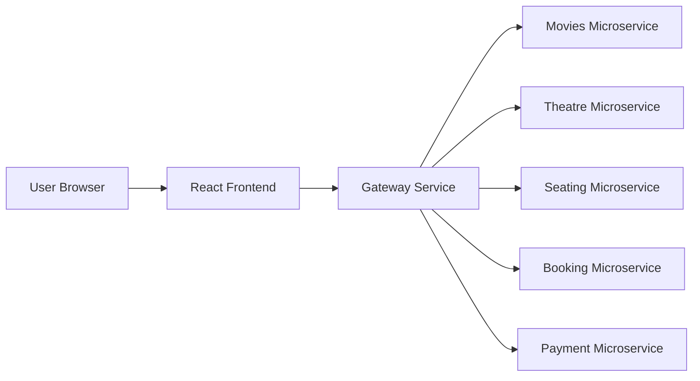

# I-Cinema Frontend Architecture

## System Context

The frontend is the user-facing application for a microservice-based movie ticket booking system. It communicates with backend services through REST APIs exposed directly or through the Gateway Service.



## Frontend Layers

- Pages: route-level screens such as Movie Catalog, Movie Details, Showtime Selection, Seat Selection, Booking Summary, Payment, and Confirmation.
- Features: domain-focused folders for movies, theatres, seating, bookings, and payments.
- Components: reusable UI controls such as movie cards, filter panels, seat cells, price summary, form fields, and alerts.
- Services: API client functions for backend communication.
- Types: shared TypeScript interfaces for movies, theatres, shows, seats, bookings, and payments.

## Planned Routes

```text
/                         Movie catalog and search
/movies/:movieId           Movie details and rating
/movies/:movieId/shows     Theatre and showtime selection
/booking/:showId/seats     Seat matrix and seat selection
/booking/:bookingId        Booking summary
/payment/:bookingId        Payment form and review
/confirmation/:bookingId   Booking confirmation
```

## API Boundary

- Movies API: list movies, search movies, get movie details, submit rating.
- Theatre API: list theatres and showtimes for a movie.
- Seating API: fetch seat map, hold selected seats, release seats.
- Booking API: create booking, calculate pricing, confirm booking.
- Payment API: validate payment request, process payment, return payment status.

## State Strategy

- Local component state for form fields, selected filters, selected seats, and UI toggles.
- Shared feature state can be introduced later if multiple distant screens need the same data.
- API responses should be typed and normalized near the service layer.

## Validation Strategy

- Search and filters validate empty input and no-result cases.
- Seat selection prevents selecting booked seats and guards requested seat count.
- Payment validates card type, 16-digit card number, future MM/YY expiration, and 3-digit CVV.
- Error states should be visible on every API-backed screen.